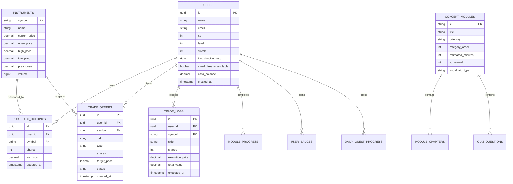

# Product Requirements Document (PRD)
## TradeWise: Gamified FinTech Education & NSE Paper Trading Platform

**Document Version:** 1.0.0  
**Status:** Living Document (Baseline Implemented + Future Roadmap)  
**Target Market:** India (NSE / BSE Retail & Academic Learners)  
**Author:** TradeWise Engineering & Product Team  
**Date:** October 2026  

---

## 1. Executive Summary & Vision

### 1.1 Executive Summary
**TradeWise** is an interactive, gamified financial education and paper-trading platform designed specifically for the Indian equity markets (NSE/BSE). It bridges the critical divide between theoretical financial literacy and real-world market execution. 

TradeWise combines:
1. **Interactive Pedagogical Modules** enriched with live computational visual aids.
2. **A Real-Time Simulated Paper-Trading Exchange** with TradingView-grade charting, limit/market order mechanics, and simulated L2 order-book dynamics.
3. **Behavioral Gamification** (XP, Level progression, Daily Quests, Duolingo-style Streaks with Streak Freezes, Badges, and a GitHub-style 52-week activity heatmap).
4. **An Engineering & CS-Grade Dev Engine** demonstrating Data Structures and Algorithms (DAA) and Database Management Systems (DBMS) concepts like Kahn's Topological Sort, Cycle Detection, Heap-based Order Matching Benchmarks, and Row-Level ACID concurrency simulation.

### 1.2 Product Vision
To empower millions of retail investors and college students to master the Indian capital markets with zero financial risk, turning complex market mechanics into an intuitive, gamified, and mathematically grounded learning experience.

---

## 2. Target Audience & User Personas

| Persona | Description | Primary Needs | Key Value Proposition |
| :--- | :--- | :--- | :--- |
| **P1: The Absolute Beginner (College Student / Young Professional)** | Has never bought a stock; intimidated by broker terminals like Zerodha Kite or Groww. | Step-by-step guidance, jargon-free explanations in INR, risk-free sandbox. | Bite-sized modules, interactive calculators (SIP/Compounding), guided paper trading with ₹1,00,000 virtual cash. |
| **P2: The Active Paper Trader** | Understands basic market concepts; wants to test trading strategies without risking real capital. | Technical indicators, candlestick charts, limit orders, PnL analytics. | TradingView-style Lightweight Charts, order execution engine, realistic order book depth, portfolio PnL tracking. |
| **P3: The Competitive Learner** | Motivated by milestones, social proof, streaks, and gamification. | Daily quests, streaks, leaderboards, achievement badges. | Daily streak rewards, streak freezes, dual leaderboards (Learning XP vs Trading PnL %), 52-week activity matrix. |
| **P4: The CS / FinTech Academic (Viva & Tech Evaluator)** | Professors, interviewers, or engineering evaluators assessing algorithms behind financial platforms. | Big-O algorithmic proofs, DAG topological sorting, ACID concurrency guarantees. | Dedicated "Dev Engine" demonstrating Kahn's algorithm, cycle injection, min-heap order matching benchmarks, and row locking. |

---

## 3. Technology Stack & Architecture

### 3.1 Implemented Frontend Architecture
- **Framework:** React 19 + TypeScript + Vite 8
- **Styling:** Tailwind CSS 4 with custom dark FinTech design system (`#0b0f19` background, `#f97316` brand orange accents, slate UI tokens)
- **Charting & Data Viz:**
  - `lightweight-charts` (TradingView's native canvas candlestick and line charts)
  - `recharts` (Responsive SVG area, line, bar, and scatter charts for educational widgets)
  - `canvas-confetti` (Celebratory milestone and quiz completion effects)
- **Icons:** `lucide-react`
- **State Management:** React Context API (`AppContext.tsx`) with real-time state synchronization, local-storage persistence, and activity logging.
- **Algorithms Module:** Custom graph traversal suite (`graphAlgorithms.ts`) implementing Kahn's algorithm (Topological Sort) and Breadth-First Search (BFS) shortest prerequisite path finder.

### 3.2 Planned Backend & Infrastructure Architecture (Roadmap)
- **Backend Framework:** FastAPI (Python) or Node.js / Express (TypeScript)
- **Database:** PostgreSQL (with Row-Level Locking, 3NF schema, and TimescaleDB extension for financial ticks)
- **Cache & Message Broker:** Redis (for session cache, pub/sub order book streams, and rate limiting)
- **Real-Time Streaming:** WebSockets for live NSE ticker data and instant order execution notifications
- **Authentication:** OAuth 2.0 / JWT (Google Auth, Phone OTP, Email/Password)
- **Market Data Feeds:** Upstox / Zerodha Kite Connect API / AlphaVantage / NSE official public endpoints

---

## 4. Current State: All Implemented Features (Phase 1 & Phase 2)

### 4.1 Guided Study Modules & Interactive Curricula
* **13 Comprehensive Modules** categorized across 5 distinct financial tracks:
  1. **Basics:**
     - *What is a Stock?* (Corporations, fractional ownership, IPO on NSE/BSE, DRHP filings, SEBI regulatory role, capital appreciation vs dividends).
     - *Compounding & Time Horizon* (Power of compounding, Rule of 72, inflation erosion).
     - *Bonds & Fixed Income* (Debt vs equity, coupon rates, yield-to-maturity, sovereign vs corporate credit).
  2. **Risk & Diversification:**
     - *Risk vs Return Tradeoff* (Beta, standard deviation, systemic vs unsystemic risk).
     - *Diversification & Asset Allocation* (Correlation coefficients, multi-asset allocation).
  3. **Instruments:**
     - *Mutual Funds & ETFs* (Active vs passive management, expense ratios, tracking error, NAV).
     - *Fundamental Analysis & Valuation* (P/E ratio, P/B ratio, debt-to-equity, balance sheets).
  4. **Trading Mechanics:**
     - *How the Order Book Works* (Bids, asks, spreads, market depth, price-time priority).
     - *Order Types & Execution* (Market orders, Limit orders, slippage, liquidity).
     - *Candlestick Charts & Technical Analysis* (Open, High, Low, Close, bullish/bearish candles, basic chart patterns).
  5. **Portfolio Strategy:**
     - *SIP & Rupee Cost Averaging* (Disciplined wealth accumulation, volatility smoothing).
     - *Portfolio Rebalancing* (Target weight drift, periodic vs threshold rebalancing).
     - *Risk Management & Stop Losses* (Position sizing, 1-2% portfolio risk rule, risk-reward ratios).
* **Multi-Chapter Interactive Reading Engine:** Step-by-step reading flow with bulleted takeaways, Indian market case studies (e.g., Reliance Industries, TCS, Tata Motors), and reading progress tracking.

### 4.2 Interactive Computational Visual Aids (13 In-Engine Widgets)
Each concept module embeds a bespoke visual simulator rendered using Recharts and custom SVG:
1. **Compounding Calculator:** Interactive slider simulator comparing Compound Growth vs Simple Interest across arbitrary tenures and rates.
2. **SIP Growth Projector:** Monthly investment slider calculating invested capital vs wealth gained.
3. **Diversification Pie Chart:** Real-time asset weighting visualizer (Equities, Debt, Gold, Cash).
4. **Risk-Return Scatter Plot:** 2D mapping of asset classes by expected return and risk volatility.
5. **Interactive Candlestick Explorer:** Live slider showing how intraday buyer/seller pressure shapes candles (green vs red, shadows/wicks vs body).
6. **Live Order Book Visualizer:** Visual bid vs ask depth ladder demonstrating market depth and spread.
7. **Bid-Ask Spread Margin Aid:** Interactive bid-ask margin calculator demonstrating transaction costs and liquidity.
8. **P/E Ratio Comparator:** Industry benchmark comparator showing relative valuation of sector peers.
9. **ETF Asset Breakdown:** Underlying basket decomposition of index ETFs (e.g., NIFTY 50 sectoral weightings).
10. **Stock Equity & Enterprise Value Visual:** Visualizing market capitalization, debt, and balance sheet structure.
11. **Bond Yield Timeline:** Visualizing bond prices vs inverse interest rate yield dynamics.
12. **Portfolio Allocation Sliders:** Dynamic portfolio builder enforcing a 100% total weight constraint.
13. **Dollar/Rupee Cost Averaging (DCA/SIP) Simulator:** Comparing lump-sum entry vs staggered DCA during bull, bear, and volatile markets.

### 4.3 Diagnostic Assessment & Quiz Engine
- **Per-Module Quizzes:** Tailored question banks testing conceptual and scenario-based understanding.
- **Immediate Answer Validation:** Instant green/red feedback with in-depth pedagogical explanations for both correct and incorrect options.
- **Scoring & XP Awarding:** Threshold-based mastery (70%+ to pass) awarding bonus XP.
- **Confetti Celebration:** Full-screen celebratory confetti on scoring 100%.
- **Review Mode:** Ability to review answers or retake quizzes to achieve perfection.

### 4.4 Learning Roadmap & Graph Traversal Engine
- **Visual Node Map:** Visual display of modules organized in pedagogical stages.
- **Directed Acyclic Graph (DAG) Gating:** Automated prerequisite validation (locks advanced nodes until upstream foundational concepts are mastered).
- **Gamified HP Mastery Header:** Dynamic game-style HP health bar reflecting total course completion percentage.
- **Fastest-Path-to-Topic Tool (BFS / Dijkstra):** Computes the minimal sequence of prerequisite nodes required to unlock any chosen advanced financial concept.

### 4.5 Paper Trading Simulator (NSE Market Sandbox)
- **Virtual Capital:** Every user begins with ₹1,00,000 virtual cash balance.
- **Real-Time NSE Market Status Engine:** Live detection checking whether the National Stock Exchange of India is currently OPEN (Mon–Fri 09:15 to 15:30 IST) or CLOSED, displaying an active pulse badge.
- **TradingView-Grade Interactive Charts (`lightweight-charts`):**
  - Candlestick, Line, Area, Bar, and Step views.
  - Multi-timeframe switching: `1D`, `1W`, `1M`, `3M`, `1Y`.
  - Live technical indicator overlays: Simple Moving Average (SMA), Exponential Moving Average (EMA), Bollinger Bands, Relative Strength Index (RSI), Moving Average Convergence Divergence (MACD).
- **Order Placement Engine:**
  - **MARKET Orders:** Instant simulated fill at Current Market Price (CMP).
  - **LIMIT Orders:** Queued in `openOrders` pending execution against price conditions; user can manually cancel open orders.
  - Position sizing calculator with "Max Buy" and "Max Sell" auto-fill based on available cash and holdings.
- **Live Search & Dynamic Instrument Injection:**
  - Searchable NSE symbol catalog (`symbols.json` covering top Indian equities: RELIANCE, TCS, INFY, HDFCBANK, TATAMOTORS, etc.).
  - On-the-fly mock stock synthesis with simulated historical OHLCV data.
- **Portfolio Analytics & Bookkeeping:**
  - Portfolio Summary: Total Equity, Available Cash, Invested Capital, Current Portfolio Value, Total Unrealized PnL (₹ and %).
  - Real-time Holdings table with live CMP, average purchase price, total value, and position PnL.
  - Open Orders management table with cancellation triggers.
  - Trade Execution History Log with timestamped audit trail.

### 4.6 Gamification, Streaks & Retention Engine
- **Experience Points (XP) & Dynamic Leveling:** Tiered leveling system scaling dynamically as users study, take quizzes, and trade.
- **Daily Streak Tracker:** Consecutive day tracking with automated daily check-in rewards (+20 XP).
- **Streak Freeze Mechanism:** Protective freeze safeguard preventing streak loss on missed days.
- **Dynamic Daily Quests:**
  - Daily pool of quests (e.g., "Study any concept today", "Place a limit order in the simulator", "Pass a quiz with a perfect score", "Place 3 trades").
  - Automated progress incrementing triggered by user actions across the app.
  - Direct XP claim modal upon quest completion.
- **Achievement Badges:**
  - Categorized under Learning, Trading, and Streak categories (e.g., *First Step*, *Quiz Perfectionist*, *First Paper Trade*, *The Diversifier*, *5-Day Streak*, *Limit Order Master*, *Basics Master*, *Profit Maker*).
  - Real-time unlock triggers and visual trophy showcase.

### 4.7 Social & Competitive System
- **Dual Leaderboards:**
  - **Learning Leaderboard:** Ranked globally by total XP accumulated.
  - **Trading Leaderboard:** Ranked by simulated Portfolio Return percentage (+PnL %).
- **Top 3 Podium Display:** Visual podium highlights for Gold, Silver, and Bronze leaders.
- **User Rank Benchmarking:** Explicit highlight placing the current user relative to competitive peers.

### 4.8 52-Week GitHub-Style Activity Heatmap
- **Full 364-Day Activity Matrix (52 Weeks x 7 Days):**
  - Tracks every user learning session, completed quiz, and executed trade.
  - Visual color intensity gradation based on daily activity density.
  - Interactive tooltip audit displaying exact date, day, and activity counts.

### 4.9 DAA & DBMS Engineering Proof Suite ("Dev Engine")
An interactive engineering demonstration built for technical defense, viva reviews, and systems evaluation:
1. **Kahn's Topological Sort & Cycle Detection:**
   - Computes topological valid study ordering across all course modules.
   - **Deadlock Cycle Injection:** Interactive button that injects a cyclic circular dependency into the DAG to demonstrate cycle detection, displaying affected cycle nodes and system alerts.
2. **Order-Matching Engine Big-O Benchmark:**
   - Interactive volume stress test (1,000 to 50,000 orders).
   - Side-by-side execution latency comparison:
     - **Min/Max-Heap (Priority Queue):** $O(\log N)$ matching.
     - **Sorted Array:** $O(N \log N)$ sorting overhead.
     - **Unsorted Linear Scan:** $O(N^2)$ worst-case latency.
3. **Row-Level ACID Concurrency Lock Simulator:**
   - Visual multithreaded simulation (Thread A vs Thread B) attempting simultaneous balance deductions on the same user account.
   - Demonstrates row-level locking, deadlock prevention, and prevention of race conditions.
4. **Relational 3NF Database Schema Visualizer:**
   - Interactive schema inspector illustrating Third Normal Form (3NF) relational tables (`users`, `modules`, `orders`, `holdings`, `transactions`, `badges`) with primary/foreign key relationships.

---

## 5. Future State: All Planned Features (Phases 3 to 8)

The following capabilities represent the product roadmap to scale TradeWise from a client-side prototype into a full-scale commercial FinTech learning ecosystem.

```
+---------------------------------------------------------------------------------------+
|                               TRADEWISE PRODUCT ROADMAP                               |
+---------------------------------------------------------------------------------------+
| [Phase 3] Backend & Persistence (PostgreSQL, FastAPI, Auth, Cloud Sync)               |
| [Phase 4] Live Market Feeds & WebSocket Tickers (Real NSE Tick Streaming)             |
| [Phase 5] Derivatives Sandbox (Futures, Options Chain, Option Greeks)                 |
| [Phase 6] Social & Institutional (Classroom Cohorts, Trading Contests)                |
| [Phase 7] AI Financial Tutor & Sentiment Engine (LLM Insights, News Sentiment)        |
| [Phase 8] Mobile App & Cross-Platform (React Native / PWA, Push Notifications)        |
+---------------------------------------------------------------------------------------+
```

### 5.1 Phase 3: Production Backend & Cloud Persistence
- **Dedicated REST & WebSocket API:** Migrate from React Context / local-storage to a secure backend built with FastAPI (Python) or Express/NestJS (TypeScript).
- **PostgreSQL Database with 3NF Schema:** Permanent persistence of user accounts, order logs, transaction ledgers, quiz attempts, and quest states.
- **Enterprise Authentication & Security:**
  - Secure JWT authentication with refresh token rotation.
  - Google Single Sign-On (SSO) and mobile phone OTP verification.
  - Role-Based Access Control (RBAC) supporting standard learners, university instructors, and system administrators.
- **Multi-Device Synchronization:** Seamless cloud sync allowing users to switch between desktop and mobile without loss of progress or open orders.

### 5.2 Phase 4: Live Market Feeds & Real-Time Exchange Simulation
- **Real-Time Market Data Integration:**
  - Direct integration with licensed market data vendors (Zerodha Kite Connect, Upstox Developer API, or Yahoo Finance / AlphaVantage).
  - WebSocket stream pushing live tick-by-tick LTP (Last Traded Price), Volume, and 5-depth bid/ask books during active NSE market hours (09:15 - 15:30 IST).
- **Simulated Matching Engine with Slippage & Liquidity:**
  - Dynamic execution incorporating real order-book depth.
  - Realistic market impact simulation: large order volumes experience realistic price slippage based on real traded volume.
  - After-Market Orders (AMO): Capability to queue orders outside market hours for execution at market open (9:15 AM).

### 5.3 Phase 5: Derivatives Sandbox & Advanced Order Types
- **Futures & Options (F&O) Paper Trading:**
  - NIFTY 50 and BANKNIFTY weekly and monthly options contracts.
  - Interactive NSE-style Option Chain visualizer displaying Strike Prices, Call/Put Open Interest (OI), Change in OI, and Implied Volatility (IV).
  - Real-time Option Greeks visualizer calculating Delta, Gamma, Theta, and Vega.
  - Payoff diagram generator for multi-leg strategies (Straddles, Strangles, Bull Call Spreads, Iron Condors).
- **Advanced Execution Orders:**
  - **Stop-Loss (SL) & Stop-Loss Market (SL-M) Orders:** Automated risk limitation orders executing upon price breaches.
  - **Trailing Stop-Loss Orders:** Dynamic stop-loss adjusting upward as the stock moves in favor of the trade.
  - **Bracket Orders (OCO - One Cancels Other):** Simultaneous entry with coupled Target Profit and Stop-Loss triggers.
  - **Good-Till-Triggered (GTT) Orders:** Long-term pending orders valid up to 1 year for positional investors.

### 5.4 Phase 6: Social, Institutional & Multiplayer Features
- **Classroom & University Portals:**
  - Dedicated instructor dashboard allowing finance professors to assign specific modules and quizzes.
  - Class-wide analytics measuring average quiz scores, common misconception areas, and completion rates.
- **Scheduled Trading Competitions & Leagues:**
  - Timed paper-trading tournaments (e.g., "Inter-College 30-Day FinTech Cup").
  - Fixed initial capital, synchronized start/end dates, and anti-cheat constraints.
  - Real-time tournament leaderboards with automated certificate generation.
- **Social Trading & Peer Portfolios:**
  - Public learner profiles showcasing verified badges, module certifications, and trading win-rates.
  - "Inspect Portfolio" feature allowing top learners to share their simulated asset allocation without disclosing cash balances.

### 5.5 Phase 7: AI Financial Mentor & Sentiment Intelligence
- **AI FinTech Tutor (Contextual LLM Assistant):**
  - "Ask TradeWise AI" assistant integrated directly into study chapters and stock charts.
  - Clarifies complex financial concepts (e.g., explaining why a high P/E stock might still be attractive, or breaking down a company's quarterly results in simple terms).
- **Automated Stock Breakdown & Financial Health Score:**
  - AI-generated summaries of company annual reports, quarterly EPS trends, and debt ratios.
  - Visual traffic-light rating (Green/Yellow/Red) for financial health, valuation, and growth.
- **News Sentiment Analyzer:**
  - Live RSS and financial news ingestion from Indian financial publications (Economic Times, LiveMint, MoneyControl).
  - Sentiment scoring algorithm labeling news headlines as Bullish, Neutral, or Bearish, linking headlines directly to relevant stock charts.

### 5.6 Phase 8: Mobile-First Optimization & Cross-Platform Apps
- **Progressive Web App (PWA):**
  - Offline study mode enabling users to read completed chapters and take practice quizzes without an active internet connection.
  - Installable home-screen web application on Android and iOS.
- **Native Mobile Apps (React Native):**
  - Optimized for one-thumb smartphone navigation.
  - Native biometric login (Fingerprint / Face ID).
  - Push notifications for daily streak reminders, market opening bell alerts (9:15 AM IST), and triggered limit order executions.

---

## 6. Functional Requirements Matrix

| Module ID | Feature Name | Description | Current Status | Target Phase |
| :--- | :--- | :--- | :--- | :--- |
| **FR-EDU-01** | Modular Study Tracks | 13 curated modules across Basics, Risk, Instruments, Mechanics, and Strategy. | **Implemented** | Phase 1 |
| **FR-EDU-02** | Interactive Visual Aids | 13 computational simulators embedded into chapters (SIP, Compounding, Order Book, etc.). | **Implemented** | Phase 1 |
| **FR-EDU-03** | Quiz & Diagnostic Engine | Multi-question assessments with real-time feedback, explanations, and confetti rewards. | **Implemented** | Phase 1 |
| **FR-EDU-04** | Prerequisite DAG Engine | Dynamic node unlocking based on upstream module completion using graph traversal. | **Implemented** | Phase 2 |
| **FR-EDU-05** | BFS Shortest Path Finder | Computes minimal prerequisite sequence to achieve any selected learning objective. | **Implemented** | Phase 2 |
| **FR-EDU-06** | AI Concept Tutor | Conversational assistant clarifying doubts and answering custom finance questions. | **Planned** | Phase 7 |
| **FR-TRD-01** | Virtual Cash Management | ₹1,00,000 initial virtual cash with dynamic debit/credit ledger. | **Implemented** | Phase 1 |
| **FR-TRD-02** | TradingView Charting | Multi-timeframe canvas charts with SMA, EMA, Bollinger, RSI, and MACD indicators. | **Implemented** | Phase 2 |
| **FR-TRD-03** | Market & Limit Orders | Order ticket supporting instant market execution and queued limit fills. | **Implemented** | Phase 1 |
| **FR-TRD-04** | NSE Market Hours Checker | System checks IST time window (09:15 - 15:30) and displays market status. | **Implemented** | Phase 2 |
| **FR-TRD-05** | Portfolio & PnL Engine | Real-time calculation of total equity, unrealized PnL, cost basis, and holding weights. | **Implemented** | Phase 1 |
| **FR-TRD-06** | Live NSE WebSocket Feed | Real-time tick ingestion replacing mock random walks with actual market prices. | **Planned** | Phase 4 |
| **FR-TRD-07** | Stop-Loss & OCO Orders | Advanced order execution logic with bracket orders and trailing stop-losses. | **Planned** | Phase 5 |
| **FR-TRD-08** | F&O Derivatives Trading | NIFTY Options chain, Option Greeks (Delta/Theta), and strategy payoff builder. | **Planned** | Phase 5 |
| **FR-GAM-01** | XP & Level Progression | Dynamic leveling system incentivizing studying, quizzes, and trade execution. | **Implemented** | Phase 1 |
| **FR-GAM-02** | Daily Streaks & Freeze | Streak counter tracking continuous daily logins with streak freeze protection. | **Implemented** | Phase 2 |
| **FR-GAM-03** | Daily Quests Engine | Rotating pool of daily missions with automatic progress tracking and XP claiming. | **Implemented** | Phase 2 |
| **FR-GAM-04** | Achievement Badges | 8+ unlockable badges across Learning, Trading, and Consistency categories. | **Implemented** | Phase 1 |
| **FR-GAM-05** | Dual Leaderboards | Global rankings sorted by XP (Learning) and Portfolio Return % (Trading). | **Implemented** | Phase 2 |
| **FR-GAM-06** | 52-Week Activity Heatmap | 364-cell visual matrix displaying daily activity density (reads, quizzes, trades). | **Implemented** | Phase 2 |
| **FR-GAM-07** | Trading Tournaments | Multi-user scheduled competitions with prizes and anti-cheat constraints. | **Planned** | Phase 6 |
| **FR-DEV-01** | Topological Sort (Kahn's) | Live demonstration of DAG topological ordering for prerequisite resolution. | **Implemented** | Phase 2 |
| **FR-DEV-02** | Cycle Deadlock Simulator | Injects circular dependencies to demonstrate cycle detection in educational graphs. | **Implemented** | Phase 2 |
| **FR-DEV-03** | Order Matching Benchmarks | Performance benchmark comparing Min-Heap vs Sorted vs Unsorted algorithms. | **Implemented** | Phase 2 |
| **FR-DEV-04** | ACID Concurrency Simulator | Demonstrates thread-safe row locking and prevention of double-spending races. | **Implemented** | Phase 2 |
| **FR-DEV-05** | Relational 3NF Visualizer | Interactive schema diagram showing normalized database architecture. | **Implemented** | Phase 2 |

---

## 7. Data Models & Relational Architecture

### 7.1 Core Schema (Relational 3NF Model)



---

## 8. Non-Functional Requirements (NFRs)

### 8.1 Performance & Latency
- **Client-Side Responsiveness:** Initial page load under 1.5 seconds on standard 4G broadband in India.
- **Chart Render Speed:** `lightweight-charts` must maintain 60 FPS during zooming, panning, and indicator toggle interactions.
- **Order Matching Simulation:** In-browser mock execution under 50ms for market orders; backend order-matching benchmark demonstrates sub-millisecond heap operations.

### 8.2 Security & Data Privacy
- **Client Sandbox Security:** All paper-trading capital remains strictly virtual; no real financial accounts or UPI details are ever requested.
- **Zero Financial Advice Liability:** Persistent SEBI educational disclaimer displayed across all public footers and simulator views:
  > *"TradeWise is an educational simulation platform. All content is for learning purposes only and does not constitute financial advice. Paper trading results do not reflect real market outcomes. Please consult a SEBI registered financial advisor before making real investment decisions."*
- **Authentication Security (Phase 3):** Passwords hashed using `bcrypt` (cost factor 12) with HTTP-only, secure, SameSite cookies for JWT session tokens.

### 8.3 Reliability & Availability
- **Client Fault Tolerance:** Graceful fallback to cached mock data if external API feeds become unavailable.
- **Offline Study Support (Phase 8):** Service workers and IndexedDB caching for study text and offline quizzes.

---

## 9. Success Metrics & Key Performance Indicators (KPIs)

| Metric | Target (Current Prototype) | Target (Phase 3-4 Production) |
| :--- | :--- | :--- |
| **Course Completion Rate** | 60% of initiated modules fully read | 75% module completion rate |
| **Quiz Pass Rate** | > 80% first-attempt passing rate | > 85% with review iterations |
| **Average Study Session Duration** | > 12 minutes per session | > 20 minutes per active session |
| **Paper Trades Executed** | > 3 trades per active user | > 10 trades per user per week |
| **Day-7 Streak Retention** | 40% cohort retention | 55% cohort retention |
| **Technical Viva Readiness** | 100% demonstration of DAA/DBMS benchmarks | Live interactive defense score 10/10 |

---

## 10. Release Milestones & Execution Plan

```mermaid
gantt
    title TradeWise Implementation & Roadmap Schedule
    dateFormat  YYYY-MM
    section Implemented
    Core Foundation & Curriculum Modules     :done, 2026-06, 2026-08
    Visual Aids & Simulator (TradingView)    :done, 2026-08, 2026-09
    Gamification, Streaks & Dev Engine       :done, 2026-09, 2026-10
    section Planned Roadmap
    Phase 3: Backend, PostgreSQL & Auth      :active, 2026-11, 2026-12
    Phase 4: Live NSE Tickers (WebSockets)   :2027-01, 2027-02
    Phase 5: F&O Derivatives & Option Chain  :2027-03, 2027-04
    Phase 6: Tournaments & University Portals:2027-05, 2027-06
    Phase 7: AI Financial Mentor & Sentiment :2027-07, 2027-08
    Phase 8: Mobile Apps (iOS/Android PWA)   :2027-09, 2027-10
```

---

## 11. Appendix: Terminology & Glossary
- **BSE:** Bombay Stock Exchange (established 1875).
- **NSE:** National Stock Exchange of India (automated electronic exchange).
- **SEBI:** Securities and Exchange Board of India (capital markets regulatory authority).
- **DRHP:** Draft Red Herring Prospectus (preliminary registration document filed before an IPO).
- **CMP / LTP:** Current Market Price / Last Traded Price.
- **L2 Order Book:** Level 2 market depth showing queued buyer bids and seller asks.
- **Topological Sort:** Linear ordering of vertices in a directed acyclic graph (DAG) such that every directed edge $(u, v)$ has $u$ appearing before $v$.
- **Kahn's Algorithm:** Degree-based BFS algorithm for computing topological ordering and identifying cycles.
- **ACID:** Atomicity, Consistency, Isolation, Durability — database transaction properties simulated in the Dev Engine.
